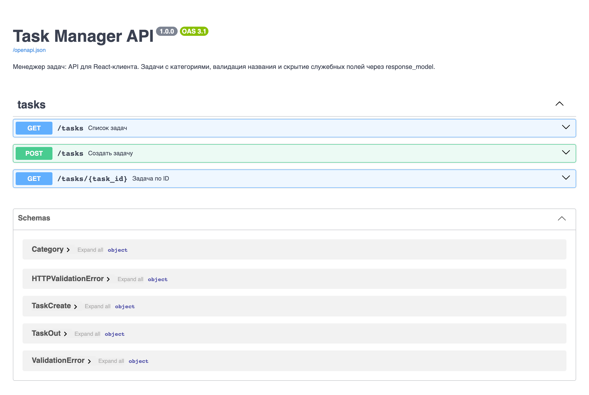
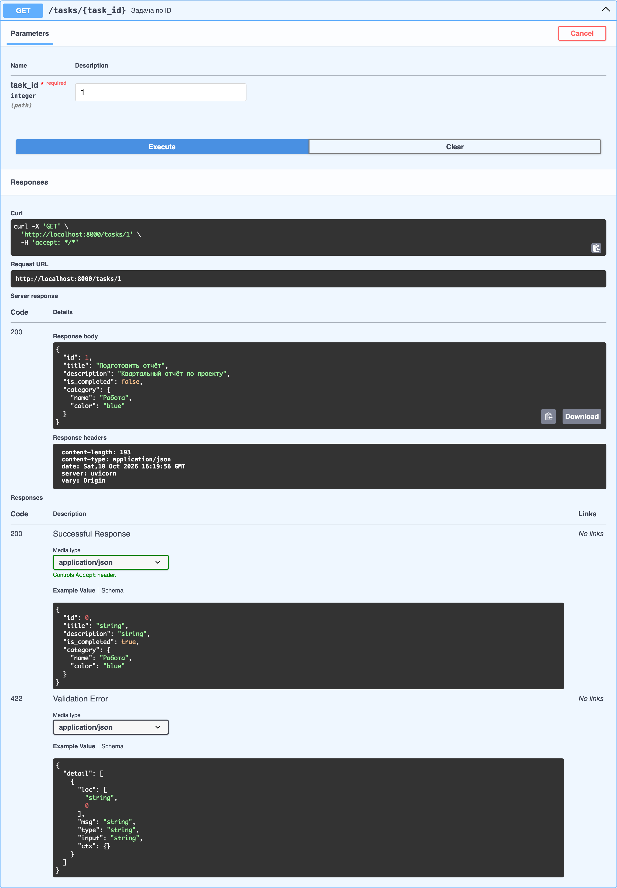
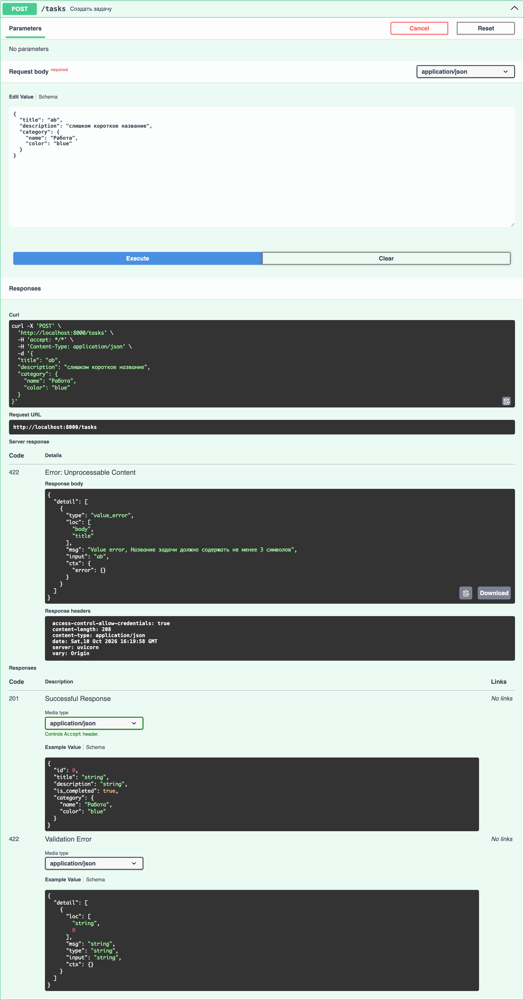
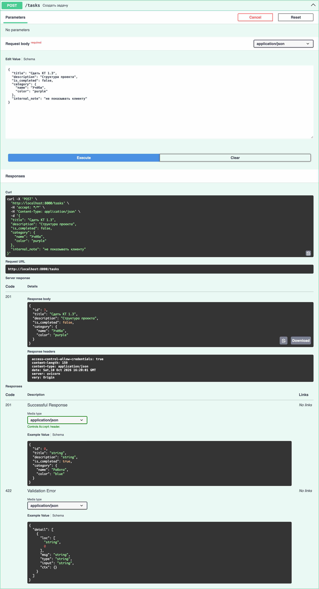

# 1.3 · Task Manager API structure

```
01-structure/
├── main.py          FastAPI app, metadata, CORS, include_router
├── config.py        settings from .env (FRONTEND_URL, APP_TITLE)
├── models/task.py   Category, TaskCreate (title validator), Task, TaskOut
├── routers/tasks.py APIRouter(prefix="/tasks", tags=["tasks"])
├── .env.example     variable names only
├── .gitignore       .env is ignored
└── requirements.txt
```

| Requirement | Where |
|---|---|
| APIRouter `/tasks` with list, create, get by id | `routers/tasks.py` |
| `Task` with nested `Category(name, color)` | `models/task.py` |
| Title shorter than 3 characters → 422 with a clear message | `TaskCreate.title_long_enough` |
| `TaskOut` hides `internal_note`, used as `response_model` | `GET /tasks/{task_id}` and the others |
| CORS origin from `FRONTEND_URL`, nothing hard-coded in `main.py` | `config.py`, `main.py` |
| Title and description visible in `/docs` | `FastAPI(title=..., description=...)` |

## Run

```bash
cp .env.example .env   # FRONTEND_URL=http://localhost:5173
pip install -r requirements.txt
uvicorn main:app --reload
```

Swagger UI: http://localhost:8000/docs. Tests: `pytest -q test_api.py`.

## Screenshots

| | |
|---|---|
|  |  |
|  |  |
