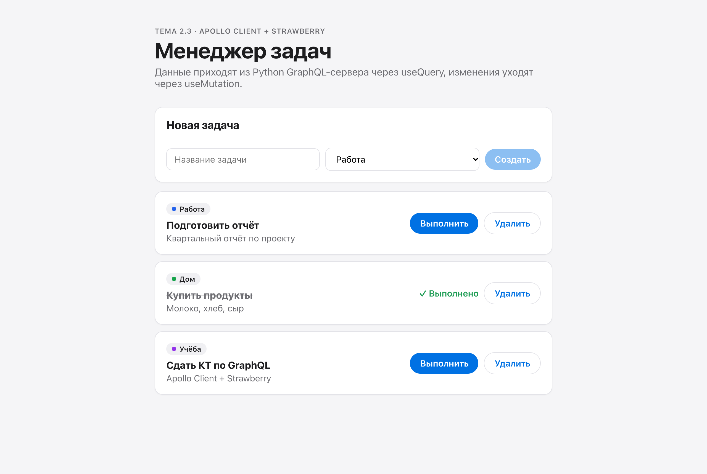
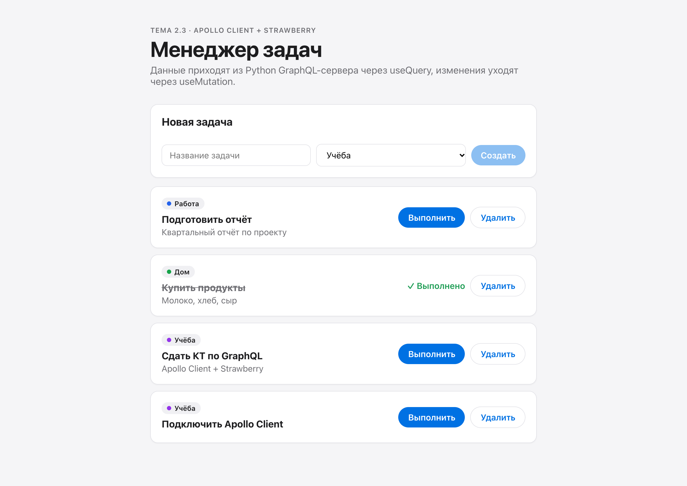
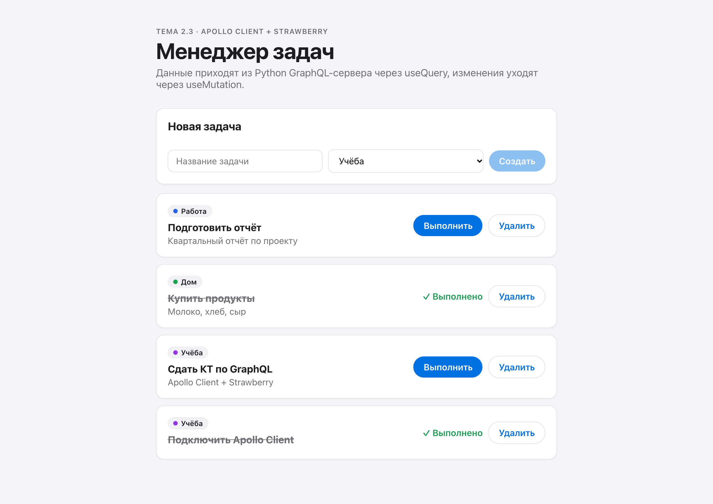
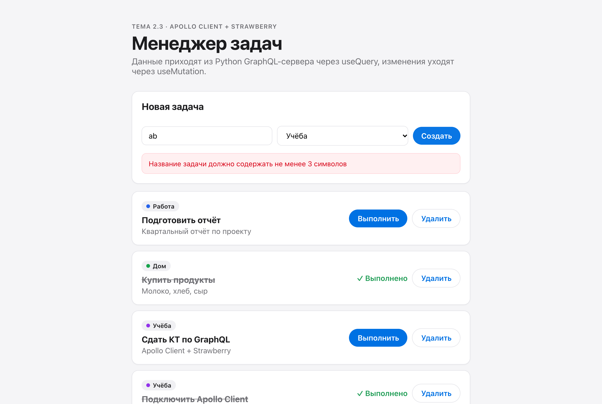
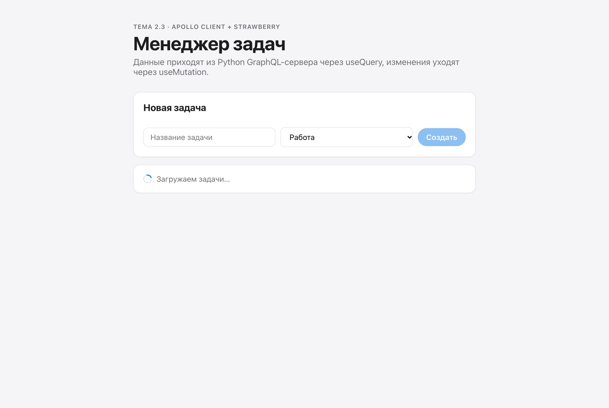
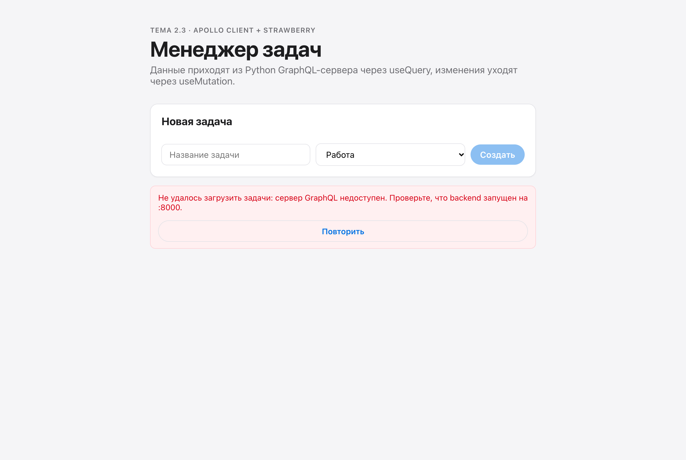
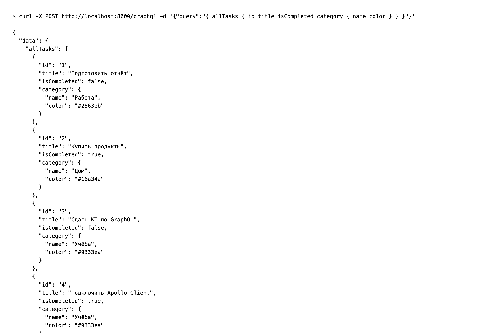
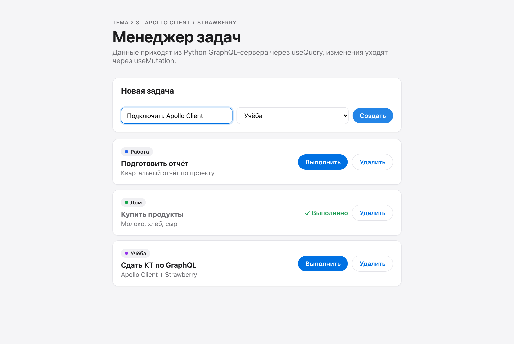

# 2.3 · Apollo Client + Strawberry

`backend/` is the Python GraphQL server (Strawberry on FastAPI, endpoint `/graphql`), `frontend/` is the React 18 Task Manager on Apollo Client.

| Requirement | Where |
|---|---|
| `ApolloClient` with the server `uri`, `ApolloProvider` at the top | `frontend/src/apollo.js`, `frontend/src/main.jsx` |
| `TaskList` runs `allTasks` and shows title, description, status and nested `category` | `frontend/src/components/TaskList.jsx` |
| Loading indicator and a clear error with retry | `TaskList.jsx` |
| Form on `useMutation` with `variables`, input cleared after submit | `frontend/src/components/TaskForm.jsx` |
| List refreshes without reload | `refetchQueries: [ALL_TASKS]` |
| Queries and mutations in their own files | `frontend/src/graphql/queries.js`, `mutations.js` |
| Extra mutations | `completeTask`, `deleteTask` |

## Run

```bash
cd backend && cp .env.example .env && pip install -r requirements.txt && uvicorn main:app --reload
cd frontend && cp .env.example .env && npm install && npm run dev
```

GraphiQL: http://localhost:8000/graphql. App: http://localhost:5173.

## Screenshots

| | |
|---|---|
|  |  |
|  |  |
|  |  |
|  |  |
