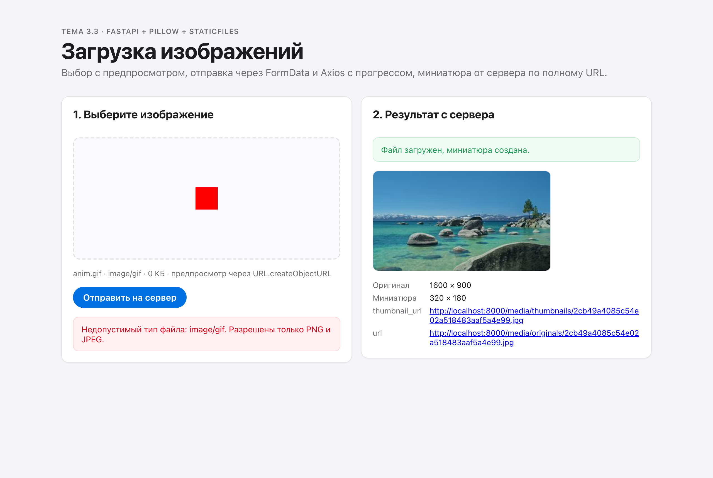
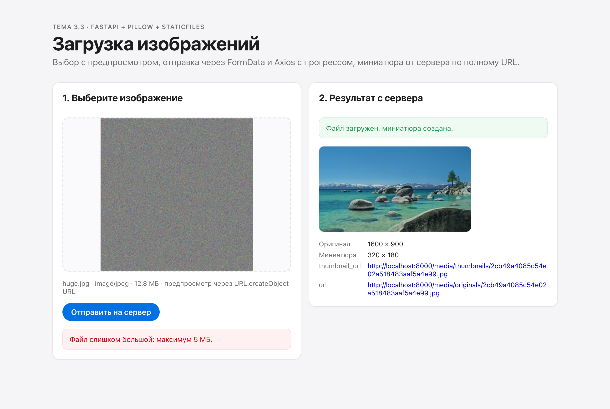

# 3.3 · Serving files and showing them in React

| Requirement | Where |
|---|---|
| `UploadFile`, only `image/png` and `image/jpeg`, at most 5 MB, clear 400 | `backend/routers/uploads.py` |
| Pillow thumbnail keeping proportions, stored apart from the original | `media/originals/` and `media/thumbnails/` |
| `StaticFiles` on `/media`, response carries full `http://` URLs | `backend/main.py`, `PUBLIC_URL` in `.env` |
| Local preview through `URL.createObjectURL` before sending | `frontend/src/components/ImageUploader.jsx` |
| `FormData` + Axios with `onUploadProgress`, shown on screen and in the console | `frontend/src/api.js` |
| Thumbnail from `thumbnail_url` shown after upload | `frontend/src/components/UploadResult.jsx` |
| Server errors shown as a message, the app keeps working | `errorMessage()` in `frontend/src/api.js` |

## Run

```bash
cd backend && cp .env.example .env && pip install -r requirements.txt && uvicorn main:app --reload
cd frontend && cp .env.example .env && npm install && npm run dev
```

## Screenshots

| | |
|---|---|
|  |  |
|  |  |
|  |  |
