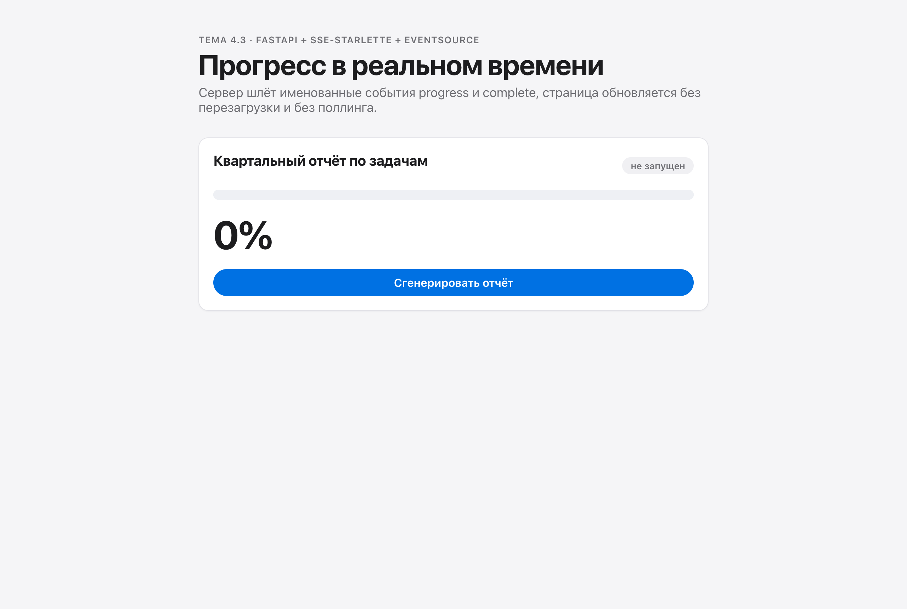
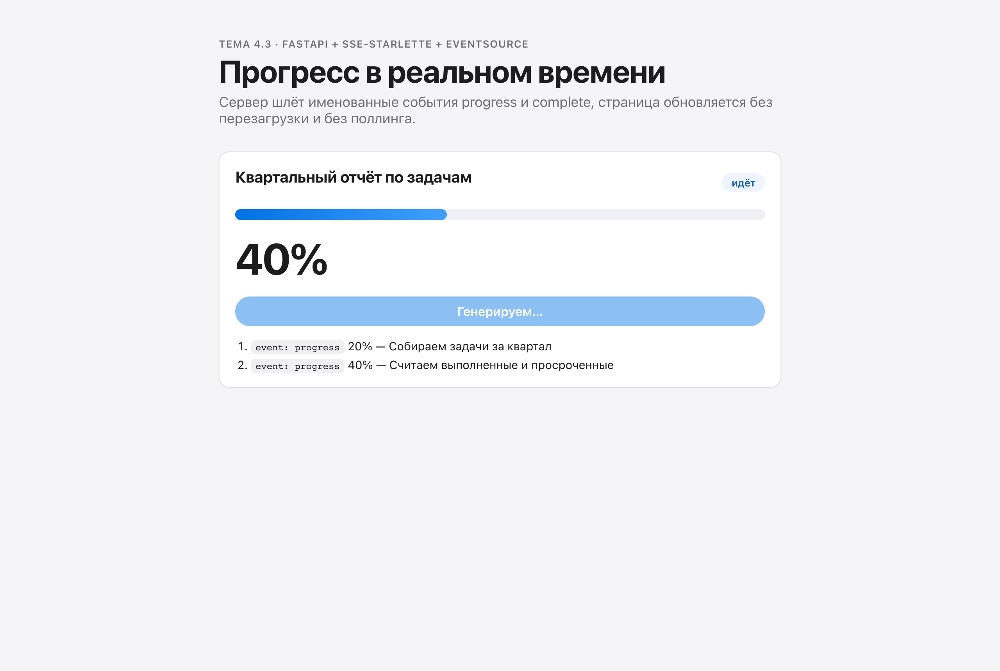
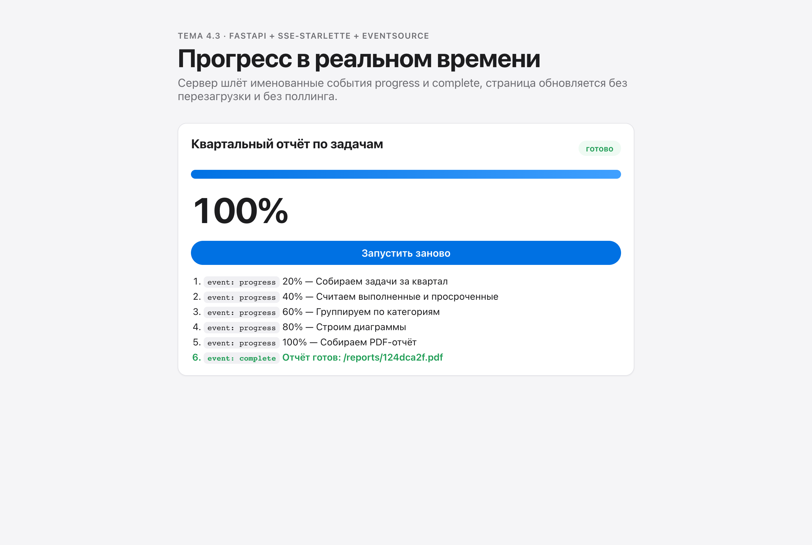
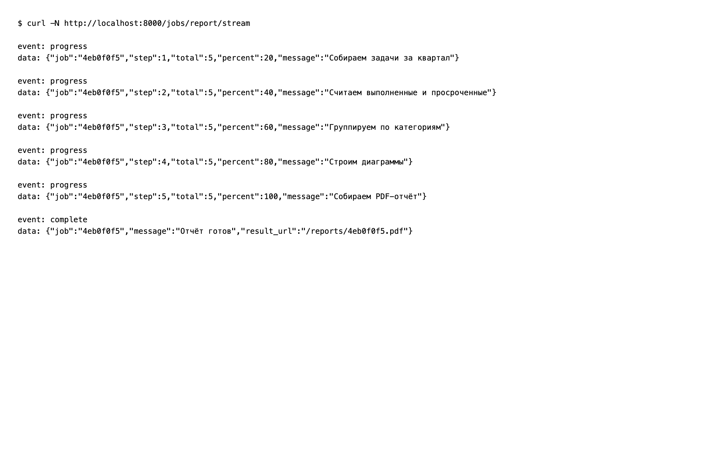

# 4.3 · SSE in React through EventSource

The backend "generates a quarterly report" and reports each stage as a Server-Sent Event; the page follows it live, without polling.

| Requirement | Where |
|---|---|
| Five `progress` events (20, 40, 60, 80, 100) and one `complete` | `backend/routers/jobs.py` |
| Named events `event: progress` / `event: complete` | `EventSourceResponse` from `sse-starlette` |
| `EventSource` created in `useEffect` with `[runId]` dependencies | `frontend/src/components/ReportProgress.jsx` |
| `addEventListener` for both event names | same file |
| `<progress>` plus a large percentage updating live | same file |
| `close()` on `complete` and in the `useEffect` cleanup | same file |
| `onerror` with a message for the user | same file |

## Run

```bash
cd backend && cp .env.example .env && pip install -r requirements.txt && uvicorn main:app --reload
cd frontend && cp .env.example .env && npm install && npm run dev
```

## Screenshots

| | |
|---|---|
|  |  |
|  |  |
