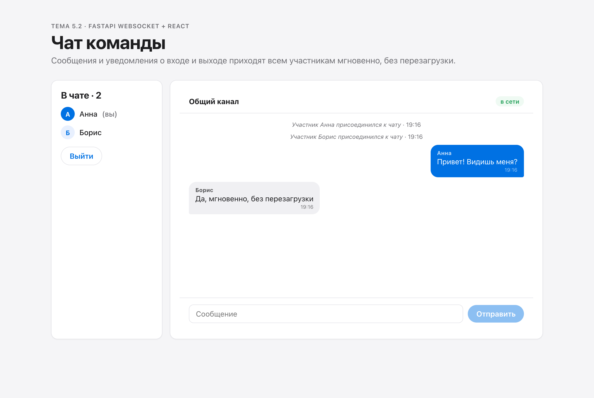
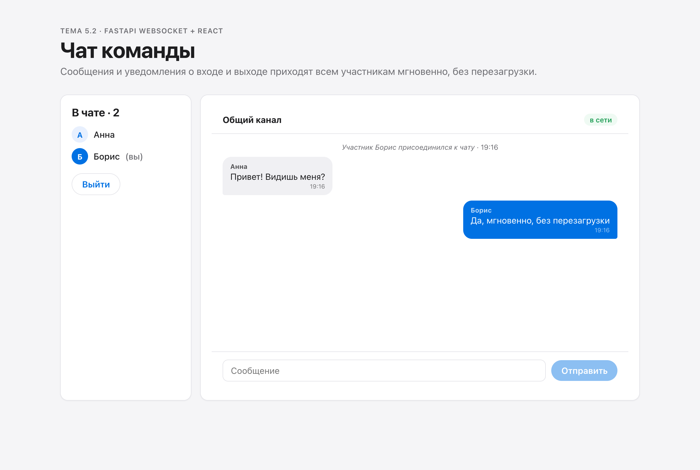
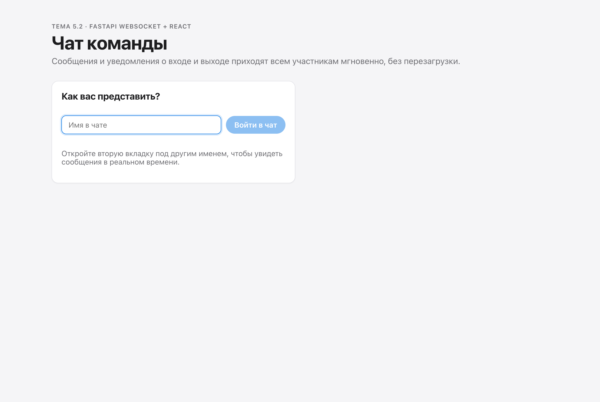

# 5.2 · Real-time chat: Python + React

| Requirement | Where |
|---|---|
| `ConnectionManager` keeping sockets by username (`dict`) | `backend/manager.py` |
| System messages to everyone on join and leave | `backend/routers/chat.py` |
| Messages as JSON `type`, `username`, `text`, `timestamp` via `receive_json` / `send_json` | `backend/models/message.py` |
| Socket opened with the name in the path, `/ws/{username}` | `frontend/src/useChat.js` |
| Sending with `ws.send()`, messages appear live | `frontend/src/components/ChatRoom.jsx` |
| System messages in italics, centred; own messages on the right | `frontend/src/app.css` |
| Tested in two tabs with different names | screenshots 02–04 |

## Run

```bash
cd backend && cp .env.example .env && pip install -r requirements.txt && uvicorn main:app --reload
cd frontend && cp .env.example .env && npm install && npm run dev
```

Open http://localhost:5173 in two tabs and join under two names.

## Screenshots

| | |
|---|---|
|  |  |
|  |  |
