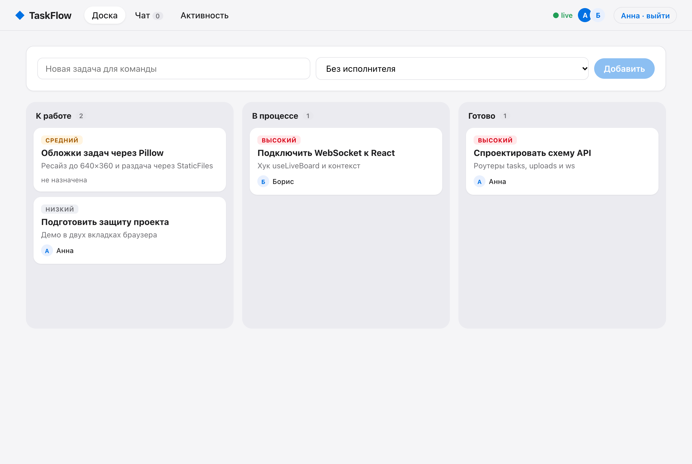
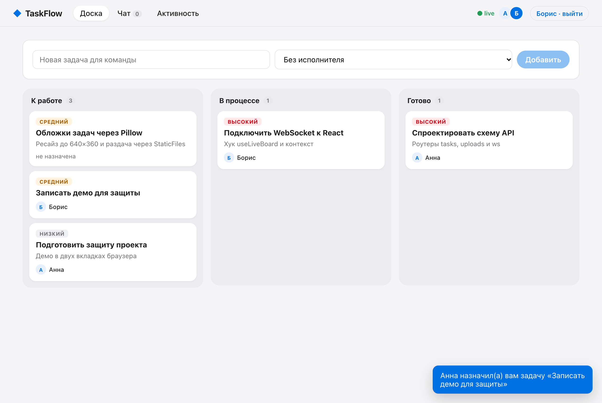
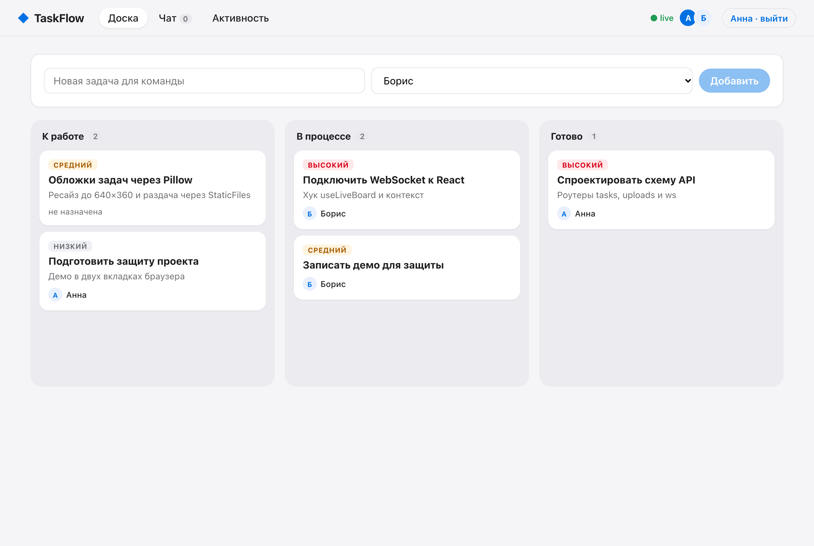
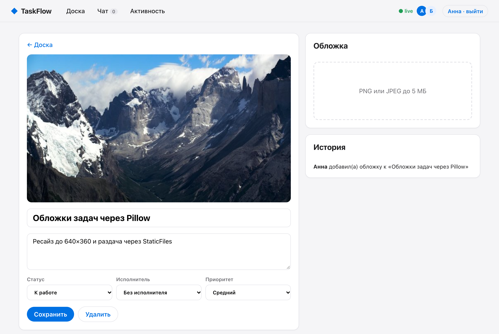
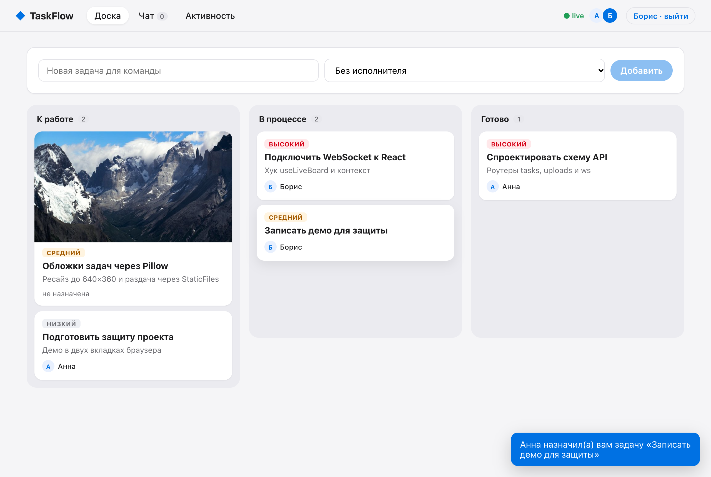
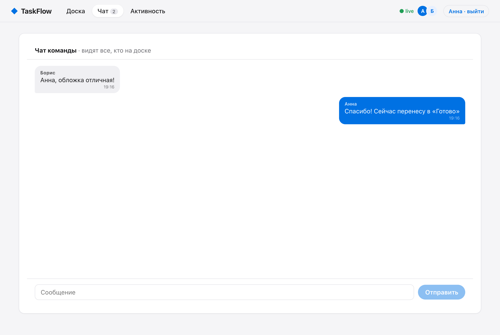
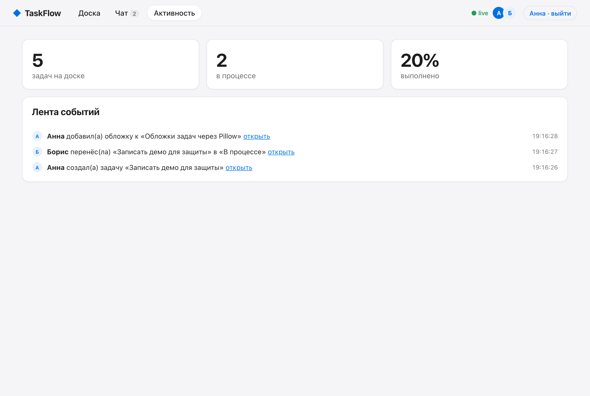
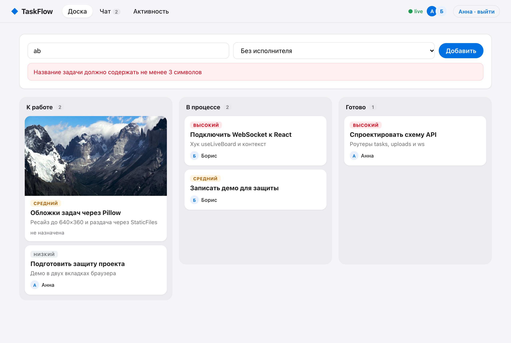

# 6.2 · Final project: TaskFlow

A team task board that updates live for everyone on it. Changes go through REST, every client learns about them over one WebSocket, covers are processed by Pillow.

```
backend/
├── main.py            app, CORS from .env, routers, StaticFiles /media
├── config.py          FRONTEND_URL, PUBLIC_URL, MEDIA_DIR
├── manager.py         ConnectionManager: several tabs per user, broadcast, send_personal
├── events.py          publish() → activity + broadcast, notify() → personal message
├── deps.py            current user from the X-User header
├── models/            Task, TaskCreate, TaskUpdate, Status, Activity, ChatMessage
└── routers/
    ├── tasks.py       GET/POST/PATCH/DELETE /tasks
    ├── uploads.py     POST /tasks/{id}/cover (Pillow, 640×360)
    └── live.py        WS /ws/{username}: snapshot, presence, chat
frontend/src/
├── LiveBoard.jsx      one WebSocket in a context, reducer of server events, auto reconnect
├── pages/             BoardPage, TaskPage, ChatPage, ActivityPage, LoginPage
└── components/        Layout (nav, presence, toasts), TaskCard
```

| Criterion | How it is met |
|---|---|
| Backend structure, CORS through `.env` | `main.py`, `config.py`, `models/`, `routers/`; `FRONTEND_URL` |
| Real-time technology | WebSocket with `ConnectionManager`; server pushes `snapshot`, `task_created`, `task_updated`, `task_deleted`, `presence`, `chat`, `notification` |
| At least 3 screens connected to the backend | Board, task page, team chat, activity feed |
| Live updates without reload, several tabs | Drag a card in one tab, it moves in the other; covers and chat arrive the same way |
| Extras | Pillow covers via `UploadFile`, targeted notifications to the assignee apart from the broadcast (topic 5.3) |

## Run

```bash
cd backend && cp .env.example .env && pip install -r requirements.txt && uvicorn main:app --reload
cd frontend && cp .env.example .env && npm install && npm run dev
```

Open http://localhost:5173 in two windows, sign in as two people. Defence notes: [DEFENSE.md](DEFENSE.md).

## Screenshots

| | |
|---|---|
|  |  |
|  |  |
|  |  |
|  |  |
